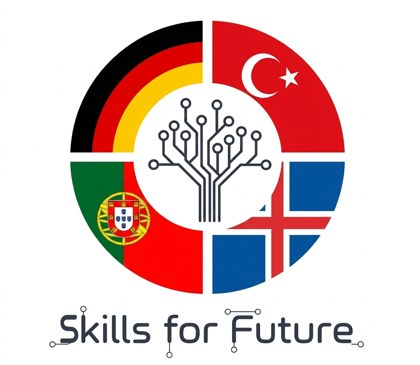

# Skills 4 Future!

Erasmus+ small-scale partnership in vocational education and training (KA210-VET)
Project number: 2025-1-DE02-KA210-VET-000353022

Four vocational schools from Germany, Portugal, Iceland and Türkiye work together to strengthen basic, digital and green skills with interactive teaching.

## Website

https://YOUR-USERNAME.github.io/Skills4Future/

## Contents

| Folder | What is inside |
|---|---|
| `index.html` | Start page of the project website |
| `products/` | Project results |
| `products/lessonplans/` | Five interactive lesson plans (Basic Skills Toolkit) |
| `assets/` | Logos used in this README |

### Lesson plans

Each lesson takes 45 minutes and has a teacher plan and a student module that runs in the browser without login.

| No. | Subject | Title | Folder |
|---|---|---|---|
| 01 | Science | The Standby Hunt | `products/lessonplans/standby-hunt/` |
| 02 | Mathematics | Tariff Showdown | `products/lessonplans/tariff-showdown/` |
| 03 | Politics and Society | Chart Detectives | `products/lessonplans/chart-detectives/` |
| 04 | German / Language | Prompt or Flop? | `products/lessonplans/prompt-or-flop/` |
| 05 | Design | Design for Every Eye | `products/lessonplans/design-for-every-eye/` |

## Partners

- Gustav-von-Schlör-Schule, Staatliche Fachoberschule und Berufsoberschule Weiden (DE), coordinator
- Eyüpsultan Borsa İstanbul Mesleki ve Teknik Anadolu Lisesi (TR)
- EPAR – Escola Profissional Almirante Reis, Lisbon (PT)
- Móðurmál – samtök um tvítyngi, Kópavogur (IS)

## Licence

All materials in this repository are licensed under [Creative Commons Attribution-ShareAlike 4.0 International (CC BY-SA 4.0)](https://creativecommons.org/licenses/by-sa/4.0/). You may share and adapt them if you give credit and keep the same licence. See the `LICENSE` file.

Suggested credit: "Skills 4 Future!, Erasmus+ project 2025-1-DE02-KA210-VET-000353022, CC BY-SA 4.0".

## Funding

Funded by the European Union. Views and opinions expressed are however those of the author(s) only and do not necessarily reflect those of the European Union or the European Education and Culture Executive Agency (EACEA). Neither the European Union nor EACEA can be held responsible for them.
